<div align="center">

# ☠ necrometer.dev

**proof of life against AI rot — static GitHub repo & org vitality audit.**

[](https://necrometer.dev/?u=necrometer-dev)

### → [necrometer.dev](https://necrometer.dev) ←

</div>

---

This repo *is* the website. Static GitHub Pages — there is no backend, no
database, no per-user image hosting. Everything happens in the visitor's
browser:

1. `necrometer.js` fetches public repos straight from `api.github.com`
   (CORS-allowed, parallel pagination). When given a GitHub URL or
   `owner/repo`, it also inspects the latest 10 commits and filters out
   automated bots (`necrometer[bot]`, `dependabot`, `renovate`,
   `github-actions`) to report the last real human commit.
2. The **Rust/WASM engine** (`pkg/`, built from
   [necrometer-dev/necrometer](https://github.com/necrometer-dev/necrometer))
   analyzes repo fates and renders the SVG card client-side. `vitality.js`
   translates the reading into a Proof-of-Life verdict (`VERIFIED ACTIVE`,
   `TOO NEW TO VERIFY`, `MIXED MAINTENANCE`, or `AI-ROT / ABANDONMENT RISK`)
   and generates a tamper-proof live-check website badge snippet.
3. You copy a **workflow** — three lines calling
   [`necrometer-dev/necrometer-action`](https://github.com/necrometer-dev/necrometer-action),
   which downloads the pinned, checksum-verified release binary and re-commits
   `necrometer.svg` to *your* profile repo daily. Placing it in your profile
   repo avoids adding daily bot commits to product repos. GitHub runs the
   compute; we host nothing.

## the ticker

The tape under the logo reads `hall.json` — a weekly census of popular,
currently-active orgs (vercel, openai, rust-lang, kubernetes, …). `hall.txt`
is the input list; `.github/workflows/hall.yml` regenerates the JSON every
Monday with the release binary.

## files

```
index.html       the whole page — proof-of-life CRT, fonts, ritual logic
site.css         CRT styling, Proof-of-Life audit panel, badge preview
necrometer.js    GitHub fetch + quota (analysis/render is wasm)
chrome.js        ticker, copy/share, install-rite text
vitality.js      Proof-of-Life verdict summary & website badge snippet
site.js          wasm glue + search → #card & #vitality-panel
pkg/             wasm build of the Rust engine (generated — don't edit)
agents.md        the install rite, written for coding agents to fetch
hall.txt         names for the weekly census
hall.json        generated ticker data
assets/          brand — skull icon + og banner (svg sources too)
necrometer.svg   this org's own card (kept fresh by necrometer.yml)
CNAME            necrometer.dev
```

---

<div align="center">
<sub>put in a name. get a reading. bind the card to your README.</sub>
</div>
